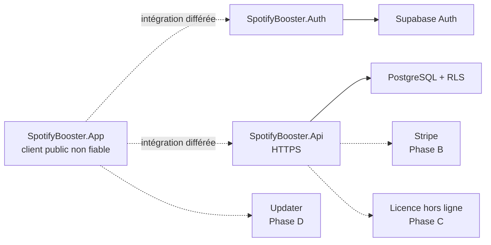

# Architecture commerciale Phase A

## Statut

La Phase A construit des frontières locales vérifiables. Elle ne constitue ni
un backend de production ni une offre commerciale opérationnelle.



Le desktop est un client public non fiable. Il ne doit jamais contenir de
`service_role`, secret Stripe, clé privée de signature ou identifiant
administrateur. L’API valide l’identité et PostgreSQL applique RLS.

## Projets et dépendances autorisées

```text
SpotifyBooster.Contracts      → aucune dépendance projet
SpotifyBooster.Core           → Contracts
SpotifyBooster.Dsp            → aucune dépendance projet
SpotifyBooster.Audio          → Core, Dsp
SpotifyBooster.Infrastructure → Core
SpotifyBooster.Auth           → Core, Contracts
SpotifyBooster.Api            → Contracts
SpotifyBooster.App            → Core, Audio, Infrastructure, Dsp
```

`SpotifyBooster.App` ne référence pas Auth en Phase A. Cette séparation évite
de présenter des écrans ou un stockage de session non livrés comme
opérationnels. `SpotifyBooster.Api` ne référence pas Auth : il valide le bearer
entrant et utilise un appel Data API limité à `/v1/me`.

Les modèles réseau restent dans `SpotifyBooster.Contracts`, sans dépendance
projet. Les abstractions applicatives `IAuthenticationService`,
`IEntitlementService` et `IUpdateService` résident dans
`SpotifyBooster.Core.Abstractions`. Ainsi, l’adaptateur Auth dépend du Core et
des contrats, tandis que les contrats wire ne dépendent d’aucune couche
applicative.

## Frontières

| Frontière | Règle |
| --- | --- |
| Audio | aucune requête réseau, persistance ou décision commerciale dans le callback |
| Auth | clé publiable dans `apikey`; bearer utilisateur par requête |
| API | JWT asymétrique validé; aucun fallback vers une clé privilégiée |
| Data API | bearer de l’utilisateur transmis par `HttpRequestMessage` neuf |
| Base | RLS forcée; profils owner-write limité, entitlements read-only |
| Secrets | développement, staging et production séparés; aucun secret dans Git |

## Phases

| Phase | Portée |
| --- | --- |
| A — actuelle | contrats, Auth/API testables, schéma/RLS local et hébergé, V3, `+75 dB` |
| B — différée | Stripe Checkout/Portal/webhooks et writer d’entitlements |
| C — différée | écrans WPF, DPAPI, licence hors ligne signée et devices |
| D — différée | updater signé et politique de mise à jour obligatoire |
| E — différée | .NET 10, production, Authenticode, SBOM et release commerciale |

Les contrats des phases suivantes stabilisent les interfaces. Ils n’accordent
aucun droit Pro et ne déclenchent aucun paiement ou téléchargement.

Le statut commercial futur `canceled` conserve Pro uniquement avant
`EntitlementExpiresAt`. Cette échéance est toujours requise pour un droit Pro
effectif et représente la fin définitive, grâce bornée incluse. Le booléen
`IsOfflineGraceActive` reste informatif et n’accorde aucun droit sans cette
échéance. À l’instant exact d’expiration et après, l’accès est désactivé. Cette
règle est évaluée dans le contrat d’entitlement central, jamais par comparaison
directe d’une chaîne Stripe dans un appelant.

## Rollback

- API : revenir au dernier artefact vérifié; la base reste source
  d’autorisation.
- JWKS : republier la clé précédente pendant le chevauchement, purger le cache
  par l’opération interne, puis vérifier les signatures.
- Base : restaurer une sauvegarde compatible et revenir aux migrations
  versionnées; ne jamais modifier une migration déjà appliquée.
- Desktop V3 : conserver le backup `settings.schema1.backup.json` ou
  `settings.schema2.backup.json`; ne pas rétrograder en écrasant `settings.json`.

Les procédures détaillées sont dans
[INCIDENT_RESPONSE.md](INCIDENT_RESPONSE.md) et
[CONFIGURATION_MIGRATION_V3.md](CONFIGURATION_MIGRATION_V3.md).
